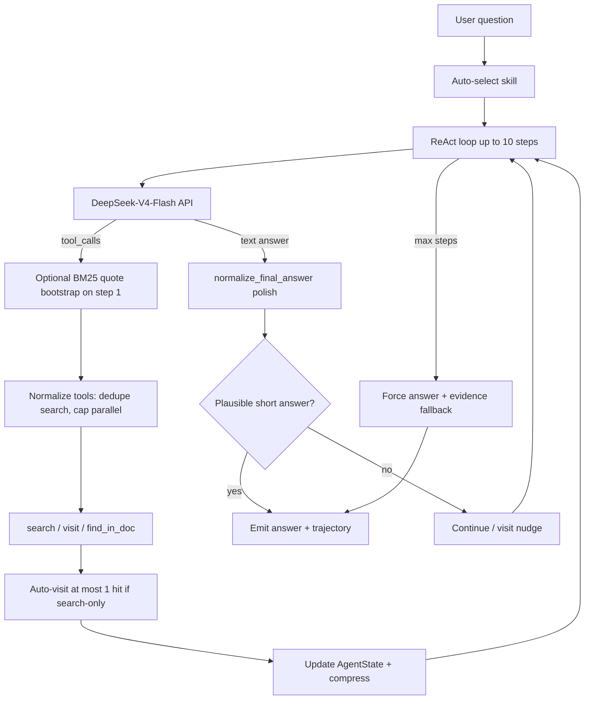

# COMP5423 Skill-Augmented Search Agent — Group Report

**Course:** COMP5423 Natural Language Processing (Fall 2026)  
**Topic:** Skill-Augmented Search Agent over BrowseComp-Plus  
**LLM backbone:** DeepSeek-V4-Flash via SiliconFlow (`CS5351/DeepSeek-V4-Flash`)  
**Due:** 26 November 2026

> Replace `Group-X` with your Canvas group id before submission. Complete the Contribution and Declaration section with real names, percentages (sum 100%), and signatures.

---

## 1. System Design Methodology

This project implements an end-to-end **skill-augmented search agent** that answers hard multi-constraint questions over a **fixed** BrowseComp-Plus document collection (100,195 documents). The system does **not** fine-tune the LLM. Gains come from retrieval design, tool coordination, an iterative agent loop, structured context management, and reusable skills.

### 1.1 Design goals

1. **Retrieve before answering** — the agent must call tools; it must not invent document IDs or URLs.
2. **Multi-step reasoning** — later actions depend on earlier search/visit results (Feature A).
3. **Structured state** — visited docs, evidence, and sub-queries live in `AgentState`, separate from raw chat history (Feature B).
4. **Reusable skills** — procedures are stored as Agent Skills directories and loaded only when selected.
5. **One unified retrieval tool** — BM25, dense (BGE), and instruction-aware (Qwen3-Embedding) backends are fused or selected inside a single `search` tool.

### 1.2 Retrieval (all three categories)

| Method | Category | Implementation |
|--------|----------|----------------|
| `bm25` | Sparse | BM25S over chunked corpus |
| `dense` | Dense encoder | `BAAI/bge-small-en-v1.5` + FAISS |
| `instruct` | Instruction-aware | `Qwen/Qwen3-Embedding-0.6B` + FAISS |
| `auto` (default) | Fusion | Reciprocal Rank Fusion (RRF, \(k=60\)) |

Chunks are ~512 words with 64-word overlap. Search returns document-level hits with scores and snippets.

### 1.3 Supporting tools

In addition to `search`, the agent can call:

- **`visit(doc_id)`** — open document text from SQLite (truncated at ~8000 characters).
- **`find_in_doc(doc_id, pattern)`** — regex/literal matches with local context (up to 8 hits).

### 1.4 Agent loop and context

`SearchAgent` (`code/src/agent/loop.py`) runs a ReAct-style loop (max 10 steps):

1. First step forces tool use when possible.
2. On step 1, if the question contains a distinctive quoted span (≥8 chars) that was not searched, the loop **bootstraps one `method="bm25"` search** for that quote.
3. Tool results are compressed and written into `AgentState`.
4. LLM context is pruned into **complete assistant↔tool turns** (never orphan `tool` messages); recent history keeps up to ~12 tool messages.
5. After a search-only turn, the loop **auto-visits at most one** unvisited hit and **caps** duplicate / parallel searches (≤2 searches/step).
6. Candidate finals pass through `normalize_final_answer` (strip prose/markdown/quotes; drop trailing Ltd/Inc/LLC; compact `D Month YYYY` → `DD/MM/YYYY`) then `is_plausible_final_answer` (reject explanation markers, `**`, multiline, length >80). There is **no hard evidence-substring reject gate** (a prior hard-grounding experiment hurt EM and was removed).
7. On max steps, the agent forces a short answer and, if needed, a **fallback** from evidence snippets.

### 1.5 Skills and automatic selection

| Skill | Role |
|-------|------|
| `multi-clue-decompose` | Split long multi-constraint questions into short sub-queries; visit before re-searching |
| `search-recovery` | Rewrite queries / switch methods after weak or empty hits |
| `constraint-verify` | Verify a candidate against every hard constraint via `find_in_doc` / visited text |

Only the skill **catalog** (name + description) sits in the base prompt. Full `SKILL.md` body loads at runtime when selected. `auto_select_skill` chooses among the three skills from the question/state (`constraint-verify` for verification-heavy / highly enumerated prompts). Mid-loop upgrade is **recovery-only** (`search-recovery` after repeated weak searches); the loop does not force-switch to `constraint-verify`.

### 1.6 User interface

Streamlit app (`code/app.py`) accepts a question and shows the final answer, selected skill, evidence, tool trajectory, and token/tool counts.

---

## 2. System Flowchart



**Entry points:** interactive UI (`app.py`) and batch eval (`run_eval.py` → `test_prediction.jsonl`).

---

## 3. Result Analysis

### 3.1 Smoke validation (first 5 questions, all indexes)

After Relative-EM boost (answer polish + stricter plausible gate + soft BM25 quote bootstrap; **no** hard grounding), the first-5 smoke scored **normalized EM = 2/5 (0.40)**.

| id | Gold | Prediction | Notes |
|----|------|------------|-------|
| 1007 | Ahmed Ezz | Ahmed Ezz | Distinctive clue hit; visit confirmed |
| 102 | 53% | 53% | Mandela Effect poll; short numeric form |
| 1005 | Folke Karl Skoog | *(empty)* | Plausible gate / max-step path; no accepted short span |
| 1019 | Rishi Kapoor | Michael Landon | Wrong entity lock-in |
| 1026 | Linus Lerner | Kent Tritle | Wrong conductor from related choir evidence |

**Interpretation:** Hits remain the easy distinctive-clue cases. Misses are wrong-entity or empty finals, not format near-misses. All three retrieval backends loaded.

### 3.2 Seeded random-8 validation (`--seed 42`)

On eight randomly sampled validation questions (fixed seed 42), the same system scored **normalized EM = 5/8 (0.625)**.

| id | Prediction (abbrev.) | EM |
|----|----------------------|----|
| 1134 | NoMBe | 1 |
| 102 | 53% | 1 |
| 22 | Jin Air Green Wings | 1 |
| 176 | Daniel Goleman | 1 |
| 1172 | Monpura | 1 |
| 774 / 944 / 149 | don't-know / wrong / empty | 0 |

### 3.3 Relative-EM-oriented hardening (within course rules)

| Change | Expected effect |
|--------|-----------------|
| Auto-visit **one** hit after search-only turns | More reading; fewer empty answers |
| Cap ≤2 searches/step; drop duplicate queries | Lower `tool_calls` / tokens (relative efficiency) |
| Turn-safe history pruning | Avoid API 400 on orphan tool messages |
| BM25 quote bootstrap on step 1 | Exact lexical hit for rare quoted spans |
| `normalize_final_answer` polish | Recover date / corp-suffix / prose format near-misses |
| Stricter `is_plausible_final_answer` (≤80 chars) | Reject explanation essays as finals |
| No hard evidence-substring gate | Avoided prior EM drop (1/5) from over-rejection |
| Evidence fallback at max steps | Fewer blank `answer` fields |

Full 100-question validation / official test EM is produced by `run_eval.py` for Canvas (do not hand-edit predictions).

### 3.4 Grading-relevant metrics (System Performance)

For each test question the submission records `answer`, full `trajectory`, `tool_calls`, and `total_tokens`. Relative scoring rewards higher normalized EM and fewer total calls/tokens across 100 test items.

---

## 4. User Interface Design

The Streamlit UI supports:

1. Entering a natural-language question.
2. Optional BM25-only mode (for machines without dense/instruct indexes).
3. Optional forced skill / disable-skills controls.
4. Inspection of: final answer, selected skill, evidence list, chronological tool trajectory, tool-call and token counts.
5. Download of a single-question prediction JSON matching the course schema.

**Screenshots:** capture the home screen, a multi-step trajectory with `search`→`visit`, and a skill-selection example for the PDF/demo.

---

## 5. Additional Exploration (Optional)

- FP16 GPU encoding for Qwen3 instruct index build on RTX 4070.
- RRF fusion of three heterogeneous retrievers behind one tool.
- Mid-loop skill switch to `search-recovery` on weak-search streak; soft `constraint-verify` selection for verification-heavy prompts.
- Context pruning that preserves full assistant/tool groups for OpenAI-compatible APIs.
- Output-side EM polish (dates, corporate suffixes, prose strip) without gold lookup or hard grounding.
- Step-1 BM25 bootstrap for distinctive quoted clues.

---

## 6. How to reproduce predictions

```bash
cd code
python -m venv .venv
# activate venv, then:
pip install -r requirements.txt
# For GPU encoding: install CUDA torch matching your driver, e.g. cu126 wheels
copy .env.example .env   # set SILICONFLOW_API_KEY

# Build indexes once (corpus must be at data/raw/corpus.jsonl)
python scripts/build_indexes.py --stage all

# Validation with EM
python run_eval.py --split val --out val_prediction.jsonl --compute-em

# Official test file for Canvas
python run_eval.py --split test --out ../test_prediction.jsonl
```

Do **not** ship `.env`, API keys, or multi-GB indexes inside the zip; share indexes via a read-only cloud link if needed.

---

## 7. Contribution and Declaration

| Member name | Student ID | Contribution (%) | Signature |
|-------------|------------|------------------|-----------|
| *(Member 1)* | | | |
| *(Member 2)* | | | |
| *(Member 3)* | | | |
| *(Member 4)* | | | |
| **Total** | | **100%** | |

We declare that this submission is the work of our group. All test answers and trajectories are produced by the submitted system. We have not hard-coded test answers, used hidden labels, or manually edited individual predictions.

Date: _______________
