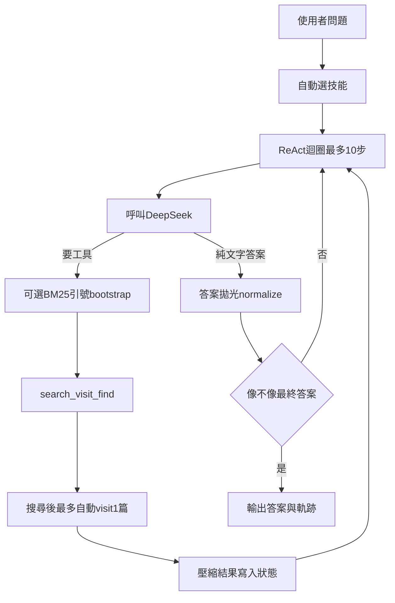

# COMP5423 技能增強搜尋代理 — 繁體中文說明報告

## 1. 一句話總覽

這支程式是一個**在固定本地文件庫上找答案的 AI 搜尋代理**：你問一個問題，它不會直接瞎猜，而是像偵探一樣反覆「搜尋 → 打開文件 → 找關鍵字 → 再搜一次」，最後只輸出一個短答案。

課程語料是 BrowseComp-Plus；語言模型用 SiliconFlow 上的 DeepSeek-V4-Flash；介面是 Streamlit，批次評測會產出課程要求的 `test_prediction.jsonl`。

---

## 2. 它解決什麼問題？

傳統「一次搜尋就讓 AI 回答」常會漏掉多條件題（例如同時要人名、年份、職稱、地點）。本系統改成：

1. **先查再答**：必須透過工具拿到文件證據。
2. **多步推理**：看完這次搜尋結果，再決定下一步要查什麼。
3. **技能輔助**：遇到複雜題或搜尋失敗時，自動套用對應策略（Skills）。
4. **控制上下文**：工具結果會壓縮、去重，避免對話越堆越長把模型搞糊。

---

## 3. 整體流程（問題 → 答案）

使用者可以用兩種入口問同一套大腦（`SearchAgent`）：

| 入口 | 檔案 | 用途 |
|------|------|------|
| 網頁介面 | `code/app.py` | 互動測試、看證據與工具軌跡 |
| 批次評測 | `code/run_eval.py` | 對 validation / test 題目大量跑預測 |

白話流程如下：

1. **收到問題**
2. **自動選技能**（或 UI 強制指定 / 關閉；含 `constraint-verify`）
3. **進入 ReAct 迴圈**（最多 10 步）：  
   呼叫 LLM → 第一步可對引號線索做 BM25 bootstrap → 若要工具就執行 → 搜尋後最多自動 `visit` 1 篇 → 壓縮結果寫入狀態 → 再呼叫 LLM
4. **若模型直接給文字答案**：先做 `normalize_final_answer` 格式拋光，再檢查「像不像短答案」；不像就催它繼續查（**沒有**硬性「答案必須出現在證據字串」閘門）
5. **結束後輸出**：答案、使用過的技能、證據、完整對話軌跡、工具次數、token 用量



對應程式：`code/src/agent/loop.py` 的 `SearchAgent.run`。

---

## 4. 資料與索引：為什麼它「找得到文件」

Agent **不能上網亂爬**，只能查你本機準備好的 BrowseComp-Plus 文件庫。所以第一次使用前要做兩件事：

1. 下載語料到 `data/raw/corpus.jsonl`（每行一篇文件：`docid`、`text`，可選 `url`）
2. 執行建索引腳本：`python scripts/build_indexes.py --stage all`

### 4.1 建索引分五個階段

| 階段 | 做什麼 | 產出大概在哪 |
|------|--------|----------------|
| `corpus` | 把 JSONL 放進 SQLite，方便之後「打開整篇」 | `data/indexes/docs.sqlite` |
| `chunks` | 把長文切成約 512 詞一段、重疊 64 詞 | `data/chunks/` |
| `bm25` | 關鍵字稀疏檢索索引 | `data/indexes/bm25/` |
| `dense` | BGE 向量 + FAISS 索引（語意相近） | `data/indexes/faiss_bge.*` |
| `instruct` | Qwen3 指令式向量 + FAISS | `data/indexes/faiss_qwen3.*` |

白話比喻：

- **SQLite 全文庫** = 書架上的完整書
- **切塊 chunks** = 把書拆成可搜尋的段落卡片
- **三種索引** = 三種不同的「找書方式」

### 4.2 三種搜尋方式差在哪

對外工具只有一個 `search`，但內部可選：

| `method` | 模型 / 技術 | 適合什麼 |
|----------|-------------|----------|
| `bm25` | 關鍵字統計（BM25） | 專有名詞、罕見拼寫、精確片語 |
| `dense` | `BAAI/bge-small-en-v1.5` | 意思相近、用詞不完全一樣 |
| `instruct` | `Qwen/Qwen3-Embedding-0.6B`（查詢會加指令前綴） | 較像自然語言問句的需求 |
| `auto`（預設） | 上面有開的都跑，再用 **RRF** 合併 | 一般情況最穩 |

**RRF（Reciprocal Rank Fusion）** 白話：  
各系統各自排出一份名單，名次越前加分越多（公式大致是 `1 / (60 + 名次)`），再把同一文件的分數加總。這樣不會只迷信某一種搜尋。

搜尋回傳的是**文件層級**結果：先在很多 chunk 裡找，再依 `doc_id` 去重，每個文件附一段 snippet（約 512 字元）。

對應程式：`code/src/retrieval/unified.py` 與各 `*_retriever.py`。

---

## 5. 三個工具：Agent 的「手」

工具定義在 `code/src/tools/`，由 `ToolExecutor` 依名稱呼叫。

### 5.1 `search` — 先找可能相關的文件

- 參數：`query`（必填）、`method`（預設 `auto`）、`top_k`（預設 7）
- 回傳：若干 `{doc_id, score, snippet, method, ...}`
- 用途：縮小候選範圍，不是直接讀完整本書

### 5.2 `visit` — 打開某篇文件細看

- 參數：`doc_id`
- 從 SQLite 取出全文，長度上限約 **8000** 字元（`VISIT_MAX_CHARS`）
- 用途：確認細節、日期、職稱等條件是否真的成立

### 5.3 `find_in_doc` — 在單篇裡搜關鍵字

- 參數：`doc_id`、`pattern`（可當 regex；失敗則改字面搜尋）
- 最多回 **8** 處匹配，每處前後約 **200** 字元上下文
- 用途：文件很長時，不必整篇硬讀

系統提示會要求：不要捏造不存在的 `doc_id`；偏好 `method=auto`；最終只回短答案字串。

---

## 6. Agent 如何「邊想邊查」

### 6.1 ReAct 迴圈（功能 A）

不是「搜一次就結束」，而是：

1. 第一步通常**強制必須呼叫工具**（避免空口回答）
2. 之後可選：繼續查，或給最終答案
3. 最多 **10** 步（`MAX_AGENT_STEPS`）
4. 若步數用完仍沒合格答案，會再逼一次「只輸出短答案」

這就是報告裡說的 iterative tool use / ReAct 風格。

### 6.2 結構化狀態 `AgentState`（功能 B）

檔案：`code/src/agent/state.py`

狀態裡記住例如：

- 已看過哪些 `doc_id`
- 累積證據 snippets（上限約 12 筆）
- 用過哪些搜尋 query
- `weak_search_streak`：連續弱搜尋幾次（空結果、幾乎沒用）
- 目前選中的 skill、目前步數

這樣模型不必只靠「超長聊天紀錄」回憶自己查過什麼。

### 6.3 上下文壓縮

檔案：`code/src/agent/context.py`

每次再問 LLM 時，大致只給：

- 系統提示 + 原始問題
- 狀態摘要（`summary_dict`）
- **最近約 12 則**工具相關訊息
- 工具原始結果會截斷到約 **3500** 字元

白話：把「筆記本精簡版」給模型，而不是整疊影印紙。

### 6.4 最終答案拋光與守門

檔案：`code/src/agent/response_utils.py`

**拋光（`normalize_final_answer`）**會：

- 去掉 `Answer:` / “Based on…” 等前綴、markdown `**`、整段包起來的引號
- 去掉尾端公司後綴（Ltd / Inc / LLC 等，且至少還剩兩個詞）
- 把 `12 August 1985` 這類日期壓成 `DD/MM/YYYY`

**守門（`is_plausible_final_answer`）**會拒絕：

- 還在規劃、還在解釋的長文（含 based on / evidence / best match 等）
- 殘留工具標記 / markup / `**`
- 過長（超過 **80** 字元）、多行、或多句解釋
- （預設）幾乎沒呼叫過工具就直接答

通過後才當成真正的 `answer`。系統**不**再做硬性「答案子字串必須出現在訪問證據」拒答（曾試過會把 EM 打低）。

---

## 7. 三個 Skills：策略說明書

Skills 放在 `code/skills/*/SKILL.md`。  
平常 system prompt **只放目錄（名稱 + 一句描述）**省 token；真正選中後才載入完整操作步驟。

### 7.1 `multi-clue-decompose`（多線索拆解）

**何時用：** 題目很長、堆很多條件（誰 / 哪個 / 何時 / 何地一起問）。

**怎麼做（技能教模型的步驟）：**

1. 先在腦中拆 2–4 個原子線索
2. 先搜**最容易命中**的短 query（`auto`；罕見引號片語可先 `bm25`）
3. `visit` 最高分未讀文件；日期題可 `find_in_doc` 找數字日期
4. 用已確認事實改寫下一輪 query
5. 交叉檢查是否滿足所有條件
6. 只輸出短答案（日期偏好 `DD/MM/YYYY`；公司名可省略 Ltd/Inc）

### 7.2 `search-recovery`（搜尋失敗救援）

**何時用：** 結果很弱、離題、實體歧義、一直撞牆。

**怎麼做：**

1. 診斷上次失敗原因（錯實體類型、錯年代等）
2. 改寫 query（拿掉廢話、加別名、加區分條件）
3. 必要時改 `bm25` / `instruct` / `dense`
4. `visit` **還沒看過**的文件
5. 成功後輸出短答案；禁止同一組 query+method 原封不動重打

### 7.3 `constraint-verify`（約束核對）

**何時用：** 題目要求核對 / 滿足多條 enumerated 條件，或已有候選人名需要逐條驗證。

**怎麼做：** 列出硬約束 → 對已訪問文件用 `find_in_doc` 逐條過關 → 任一硬約束失敗就換實體簇 → 只輸出短答案。

### 7.4 自動選取規則（啟發式）

檔案：`code/src/agent/skills_loader.py` 的 `auto_select_skill`

大致優先順序：

1. 若已有弱搜尋紀錄 → 選 `search-recovery`
2. 核對型措辭 / 編號條件很多（≥4）→ `constraint-verify`
3. 多條件訊號夠多，或字數 ≥ 28 → `multi-clue-decompose`
4. 題目含 ambiguous / aka 等 → `search-recovery`
5. 字數 ≥ 20 → 預設 `multi-clue-decompose`
6. 否則可不選 skill

另外，在迴圈中途若**連續弱搜尋 ≥ 2**，可能**中途切換**到 `search-recovery`（不會強制切到 `constraint-verify`）。

UI 也可強制指定某個 skill，或關閉自動技能。

---

## 8. 主要檔案地圖（對照用）

```
code/
  app.py                      # Streamlit 介面
  run_eval.py                 # 批次預測 / 可算 validation EM
  scripts/build_indexes.py    # 建索引
  skills/                     # 技能說明書
  src/
    config.py                 # 路徑與預設參數
    llm/siliconflow.py        # 呼叫 LLM API
    corpus/loader.py          # 讀語料、切塊
    retrieval/                # BM25 / dense / instruct / 統一 RRF
    tools/                    # search, visit, find_in_doc
    agent/                    # 迴圈、狀態、上下文、技能載入
data/
  validation.jsonl / test.jsonl
  raw/corpus.jsonl            # 需自行下載
  indexes/ 、 chunks/         # 本機建出（體積大，通常不進 git）
```

---

## 9. 重要預設參數（記幾個就好）

| 參數 | 預設 | 意思 |
|------|------|------|
| LLM | DeepSeek-V4-Flash | 經 SiliconFlow / 課程 gateway 呼叫 |
| `DEFAULT_TOP_K` | 7 | 每次搜尋回傳文件數 |
| `VISIT_MAX_CHARS` | 8000 | 打開文件最長讀多少 |
| `MAX_AGENT_STEPS` | 10 | 最多推理步數 |
| `MAX_EVIDENCE_ITEMS` | 12 | 狀態裡最多留幾筆證據 |
| `MAX_TOOL_RESULT_CHARS` | 3500 | 工具結果截斷長度 |
| 歷史工具訊息窗 | ~12 | 送給 LLM 的近期 tool turns |
| 答案長度守門 | 80 | `is_plausible_final_answer` |
| `CHUNK_SIZE` / `OVERLAP` | 512 / 64 | 切塊大小與重疊 |
| RRF `k` | 60 | 融合排名常數 |

API 金鑰請放在 `code/.env` 的 `SILICONFLOW_API_KEY`（不要提交到 git）。

---

## 10. 如何實際操作

### 10.1 環境

```bash
cd code
python -m venv .venv

# Windows PowerShell
.venv\Scripts\Activate.ps1

pip install -r requirements.txt
copy .env.example .env
# 編輯 .env，填入 SILICONFLOW_API_KEY
```

### 10.2 準備資料與索引（每台機器做一次）

1. 下載 [BrowseComp-Plus corpus](https://huggingface.co/datasets/Tevatron/browsecomp-plus-corpus) 到 `data/raw/corpus.jsonl`
2. 建索引：

```bash
cd code
python scripts/build_indexes.py --stage all
```

若暫時跳過 instruct 索引，評測可加 `--bm25-only`（功能會比較受限）。

### 10.3 開網頁介面

```bash
cd code
streamlit run app.py
```

介面會顯示：最終答案、選中的 skill、證據、工具軌跡、token / 工具次數，並可下載單題 prediction JSON。

### 10.4 產出課程提交檔

```bash
cd code
python run_eval.py --split test --out ../test_prediction.jsonl
```

驗證集並算正規化 Exact Match：

```bash
python run_eval.py --split val --out val_prediction.jsonl --compute-em
```

常用旗標：`--limit N`、`--offset K`、`--bm25-only`、`--api-key ...`

每行輸出大致長這樣：

```json
{
  "id": "...",
  "question": "...",
  "answer": "...",
  "trajectory": [...],
  "tool_calls": 0,
  "total_tokens": 0
}
```

- `tool_calls`：Agent 實際呼叫工具的次數  
- `total_tokens`：該題所有 LLM 呼叫的 `usage.total_tokens` 加總  
- `trajectory`：完整對話與工具往返紀錄  

---

## 11. 一個完整例子（假想題）

**問題（多條件）：**  
「哪位創辦人在 1998 年於某城成立公司，後來該公司產品 X 被廣泛使用？」

**可能發生的軌跡：**

1. 自動選中 `multi-clue-decompose`（題目長、條件多）
2. `search(query="1998 founded product X", method="auto", top_k=5)`  
   → 內部 BM25 + dense + instruct，RRF 融合出幾篇候選
3. `visit(doc_id="doc_A")`  
   → 讀到公司名與地點；狀態標記已讀 `doc_A`
4. `find_in_doc(doc_id="doc_A", pattern="1998|founder")`  
   → 鎖定創辦人相關句
5. 再用確認過的公司名搜第二輪：`search(query="CompanyName founder", method="auto")`
6. `visit` 另一篇交叉驗證
7. 若中途連續空結果 → 切到 `search-recovery`，改用 `bm25` 或改寫 query
8. 模型輸出短答案例如 `Jane Doe` → 通過守門 → 結束

輸出時你會看到：`answer`、`selected_skill`、`evidence`、`trajectory`、`tool_calls`、`total_tokens`。

---

## 12. 設計重點（寫報告可直接用）

1. **檢索**：對外單一 `search`；對內 BM25 + BGE dense + Qwen3 instruct，`auto` 時用 RRF 融合。  
2. **工具**：`visit` 讀全文、`find_in_doc` 精準定位。  
3. **Agent 迴圈**：多步工具使用，下一步依賴上一步結果（Feature A）；引號 BM25 bootstrap；自動 visit ≤1。  
4. **上下文**：`AgentState` 追蹤證據與已讀文件；工具輸出去重、截斷後再給 LLM（Feature B）。  
5. **Skills**：三本策略（拆題 / 救援 / 核對）；目錄先放摘要；執行時自動載入完整 `SKILL.md`，中途僅 recovery 升級。  
6. **答案拋光**：統一輸出 EM 友善格式；不做硬 grounding 拒答。

---

## 13. 給非技術讀者的最終比喻

把系統想成一位**有固定圖書館通行證的助理**：

- 圖書館就是本機 `corpus`（不能去外面亂找）
- 三種索引是三種找書方法；`auto` 是三種一起找再投票
- `visit` / `find_in_doc` 是把書打開、用螢光筆找句子
- Skills 是三本口袋策略手冊（拆題 / 卡住怎麼救 / 逐條核對）
- ReAct 迴圈是「查一下、想一下、再查一下」，最多十輪
- 最後只准交一個短答案（可先拋光格式），並附上查過什麼的紀錄交給評分系統

### 驗證摘要（與英文報告一致）

- 前 5 題 smoke（全索引）：**EM 2/5**
- 隨機 8 題（`--seed 42`）：**EM 5/8**

若只要英文技術摘要，請看 `code/README.md`；本文件是同一套系統的繁體中文白話詳解。
